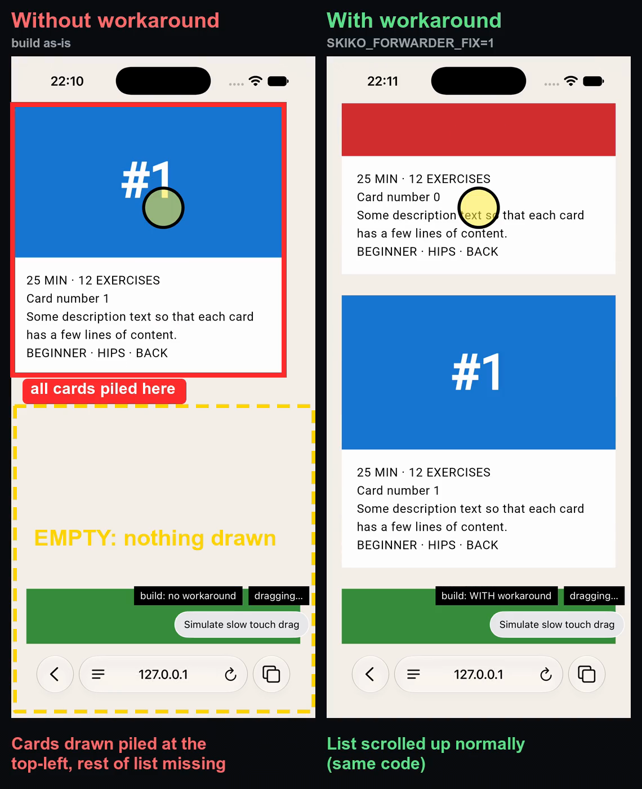

# Compose for Web in Safari 27: content drawn at the canvas origin after a slow touch drag

A minimal Compose Multiplatform (Kotlin/Wasm) project that reproduces a rendering bug in Safari 27.2
(iOS 27.2 and macOS 27.2). The whole app is one `LazyColumn` of cards: [`src/wasmJsMain/kotlin/main.kt`](src/wasmJsMain/kotlin/main.kt).

**Live:** https://marcinmoskala.com/compose-safari-drag-repro/ (no workaround)
and https://marcinmoskala.com/compose-safari-drag-repro/fixed/ (the same code built with the workaround below).

Side by side, iOS 27.2 simulator (the drag is shown at 1/4 speed, the end frame is held):

[docs/safari-27-bug-side-by-side.mp4](docs/safari-27-bug-side-by-side.mp4)



The cards have distinct colours (six strong colours in turn) and a large number (`#0`, `#1`, ...), so the broken frame is
easy to read. The yellow ring is a small page overlay that marks where the touch pointer is (see `index.html`); it has
`pointer-events: none` and does not change the bug. Earlier recordings with a real finger:
[without](docs/ios-safari-27-bug.mp4), [with workaround](docs/ios-safari-27-with-workaround.mp4).

## What happens

The user rests a finger on the list for a moment and then drags it slowly upwards. Instead of scrolling, the cards are
suddenly drawn on top of each other at the top-left corner of the canvas (without the list's 20 dp padding), and the
rest of the canvas is empty. The layout itself is correct (taps land where the cards should be); only the drawing is
wrong, and it stays that way until something triggers the next frame (e.g. the next gesture).

**Expected:** the list scrolls up by about 250 px, as in Chrome, Firefox and older Safari.

## Steps to reproduce

**iPhone / iOS simulator (iOS 27.2), with a finger**
1. Open the live link above in Safari (or any iPhone browser, they all use WebKit) and wait for the list.
2. Put a finger on the first card and keep it still for about 1 s.
3. Drag slowly upwards by about a third of the screen (roughly 70 pt every 150 ms), then release.
4. **Actual:** the broken frame shown in the video.

**Automatic, also with a mouse in desktop Safari**
1. Open the page and press **Simulate slow touch drag** (bottom right), or open it with `?auto`
   (e.g. `https://marcinmoskala.com/compose-safari-drag-repro/?auto`), which presses it 3 s after the canvas appears.
2. The button dispatches synthetic touch pointer events on the Compose canvas: `pointerdown` (pointerType `touch`) at
   y = 388, `pointermove` to y = 358, 288, 218, 138 (one every 150 ms), then `pointerup`.
3. **Actual (Safari 27.2):** after the 4th move the cards are piled at the top-left corner.
   In desktop Safari keep the window visible: a hidden window does not render frames. (The simulator results below
   are for this project; desktop Safari 27.2 was verified with the larger app this repro was cut down from.)

Load the page fresh for each attempt. On the iOS 27.2 simulator (iPhone 17) the build without the workaround showed
the broken frame in 11 of 11 fresh loads (9 with `?auto`, 3 of them on the live page, and 2 with a finger); the
build with the workaround in 0 of 8. A build of skiko's glue generated as in the proposed fix (see below), with no
webpack rewrite, in 0 of 3.
With the distinct card colours the no-workaround build showed the broken frame in 3 of 3 fresh `?auto` loads and the build with the workaround in 0 of 3. (A finger gesture injected through the simulator tool did not trigger it in 3 of 3 attempts with this version; `?auto` and the earlier finger recordings did.)
The label at the bottom right says which build is loaded.

## Versions

- Compose Multiplatform 1.12.2 (Material3 1.12.0-alpha03), skiko 0.150.2, Kotlin 2.4.21, `wasmJs` target
- Affected: Safari 27.2 on iOS 27.2 (all iPhone browsers) and on macOS 27.2
- Not affected: Chrome, Playwright WebKit 18.4

## Cause

skiko generates a JavaScript forwarder for every Skia export, which the Kotlin/Wasm module imports and calls for every
Skia call:

```js
export let f = (...a) => (f = loadedWasm._["f"])(...a)   // minified: f=(...e)=>(f=x._.f)(...e)
```

Once JavaScriptCore has optimised these forwarders, float arguments reach the Skia wasm export as zeros: Kotlin calls
`RenderNode_1nSetBounds(ptr, 60, 226, 1146, 1290)` (logged inside the forwarder), but reading the node back with
`RenderNode_1nGetBounds` gives `[0, 0, 0, 0]`, so Skia draws the node at the origin. A forwarder that contains a
`try`/`finally` is not affected:

```js
export let f = (...a) => { try { return loadedWasm._["f"](...a) } finally {} }
```

Forwarders without `try` (`(...a) => loadedWasm._["f"](...a)`, `function () { return f.apply(null, arguments) }`)
still fail. Terser (webpack's production minifier) keeps the empty `finally {}`.

## Building

Requires JDK 17+. `./gradlew wasmJsBrowserDistribution` writes the page to `build/dist/wasmJs/productionExecutable/`.
Serve that folder over HTTP (e.g. `python3 -m http.server -d build/dist/wasmJs/productionExecutable 8080`).

**With the workaround:** `SKIKO_FORWARDER_FIX=1 ./gradlew wasmJsBrowserDistribution`. This enables the webpack plugin
in [`webpack.config.d/safariSkikoGlue.js`](webpack.config.d/safariSkikoGlue.js), which rewrites the forwarders in the
finished bundle to the `try`/`finally` form above. Nothing else changes.

`index.html` also wraps `requestAnimationFrame` in a plain function; that is a separate Safari problem (without it the
page stays white) and is the same in both builds.
